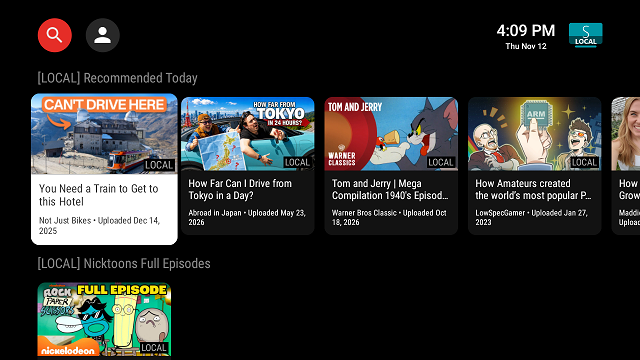
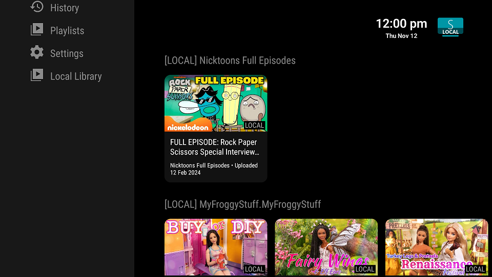
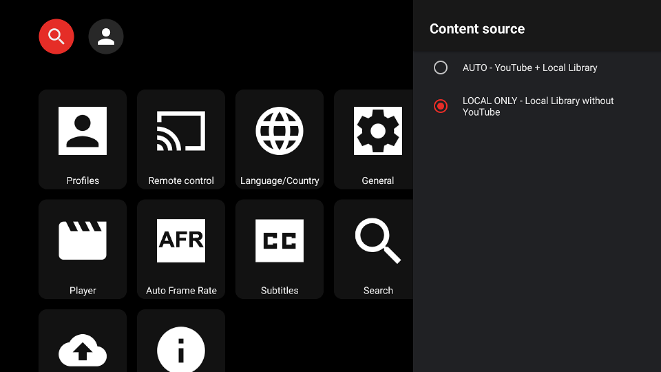
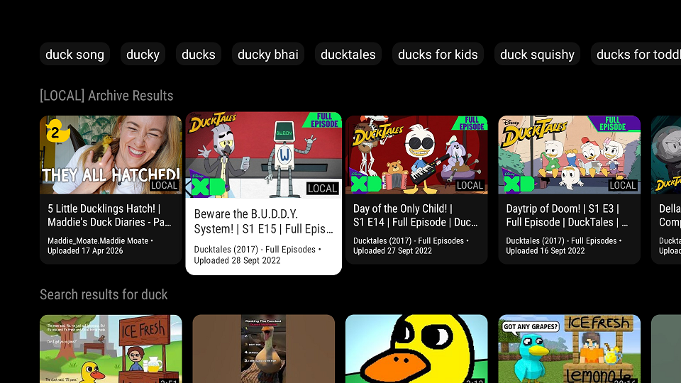
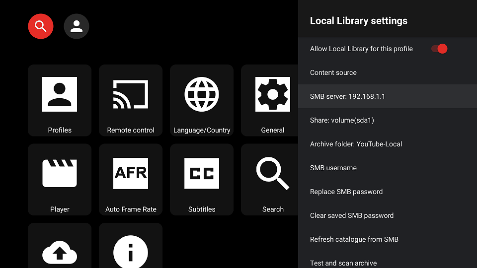

# SmartTube LOCAL

SmartTube LOCAL is an independent fork of [SmartTube](https://github.com/yuliskov/SmartTube), built for people who want the convenience of YouTube, the freedom of their own video archive, and a little more control over what appears on the family TV.

**Your TV. Your rules.**

## But why?

YouTube is great. Google... not so much.

SmartTube LOCAL takes the excellent SmartTube Android TV app and pulls an additional rabbit out of its ass: **use your own OFFLINE YouTube video library, right alongside ONLINE YouTube, WITHOUT a Google account.**

Download videos with MeTube or yt-dlp, save them to a network share, and watch them on your TV. No internet required after that. No Google account required either.

Or watch YouTube online without a Google account, block ads and sponsors, subscribe to channels, and save playlists locally.

Mix and match as you see fit.

### Explain better, computer man 

Two modes. One app.

**AUTO - YouTube + Local Library**

By your powers combined! You are Captain Youtube!

YouTube and your downloaded videos, all in one place. Browse, search, subscribe, create playlists, block ads and sponsors, and watch your own videos.

All without a Google account.

**LOCAL ONLY - Your library. Your rules.**

No internet? Ppft. No problem.

Browse your downloaded videos by channel, search your archive, open playlists, and watch everything directly from your home network.

YouTube can enshittify all it wants. You can just sit there and lol at it.

### Everybody gets their own corner?

Everybody does.

Want the kids to **ONLY** have access to your downloaded video archive?

Me too. That's why (in part) this exists.

Create separate profiles for the family, each with their own subscriptions and playlists.

Set their profiles to **LOCAL ONLY**, choose which channels or videos they can access, and protect the settings with a master password.

Now the kids can watch what you've downloaded, without an accidental detour into the brainrot side of YouTube.

Everybody shares the same video archive, so there's no need for multiple copies of anything. Each profile just sees what you've allowed.

### Can I bring my YouTube playlists and channels with me?

Of course you can. What do you think I am - a hack?

Already have a carefully curated collection of playlists and enough subscriptions to last several lifetimes?

Cool. Me too.

Import your playlists from Google Takeout and your subscriptions from NewPipe-compatible JSON.

No need to start from scratch.

### OK... what's the catch?

There is no catch. You don't even have to star this repo. 

I just got big mad about needing to provide photo ID to Google to watch frikken YouTube, so I decided to do something about it.

Then I decided to do a bit more. And a bit more.

And now, here we are.

## What do I need, computer man?

Not much. You just need to apply a soupçon of elbow grease.

Technically, you need an SMB network share for your downloaded videos. That could be a NAS, Raspberry Pi, a USB drive plugged into your router, or even a broken $20 laptop. 

Whatever works.

## Need more details?

Read the [FAQ](FAQ.md). 

## Repository Notes

This repository is maintained offline for private use, but I push updates here as a backup, and for your entertainment.

Also, because I don't want to punch holes in my firewall just to install this thing on every relatives TV.

So please, feel free to use it. In fact, host as much of your own shit as you can. 

**PS:** No support or compatibility guarantee is provided.

**PPS:** Pull requests are not accepted at this time.

**PPPS:** Please DO fork and fiddle with this to your heart's content.

**PPPPS:** As this is a vital piece of personal infrastructure (I have two kids, and SmartTube LOCAL is needed to maintain my sanity), I intend to maintain it. That may mean the project goes in directions that don't suit your needs.

To that end, I'm publishing the current **32.71 source code and final release**, with the source code frozen at this version.

Download the APKs from the [SmartTube LOCAL GitHub Releases page](https://github.com/bsgcl/SmartTubeLocal/releases).

I'll continue to publish updated APKs as I hatch them. 

Hi mum! 