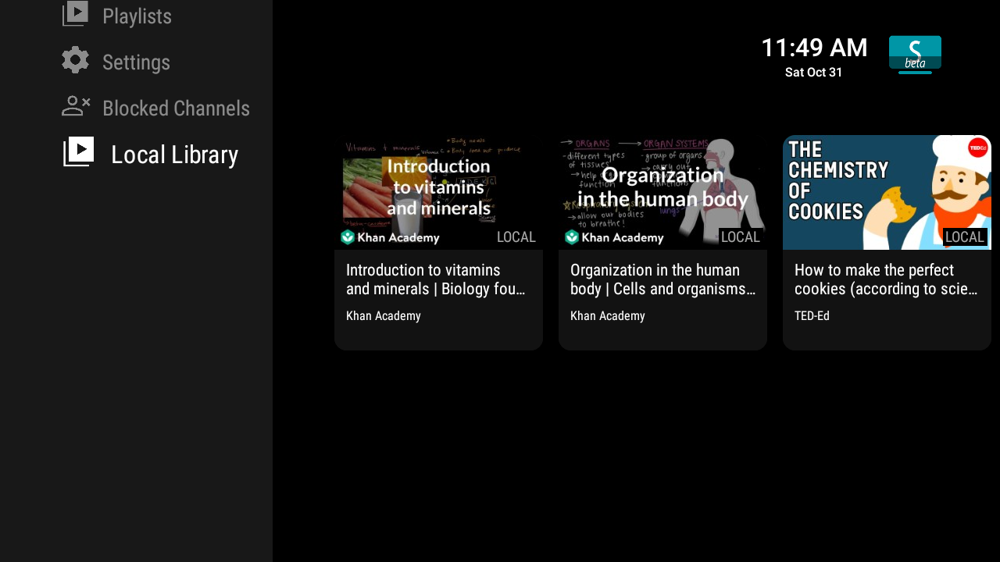
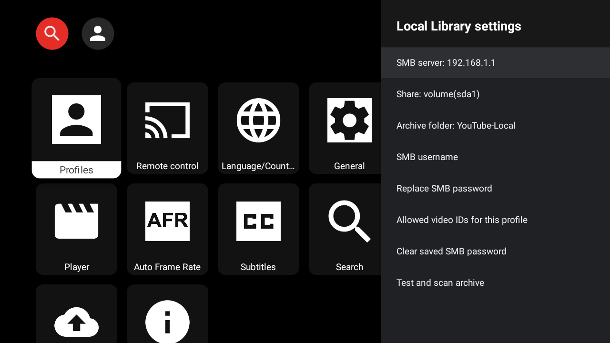

# SmartTube Local

SmartTube Local combines YouTube *without* Google sign-in, *offline playback over your home network*, and *local profiles* for subscriptions and playlists.

## Features

- **Watch downloaded videos offline.** Play your MeTube/yt-dlp archive directly from an SMB share on your home network.
- **Use YouTube without a Google account.** Browse and watch online without Google sign-in.
- **Keep profiles, subscriptions, and playlists local.** Each profile has its own subscriptions and playlists.
- **Choose which profiles can use Local Library.** Each enabled profile can access the whole archive without separate video copies.
- **Protect local profiles with passwords.**
- **Import your existing playlists and subscriptions.** Import playlists from Google Takeout and subscriptions from NewPipe-compatible JSON.
- **I'm blue da ba dee.** Find SmartTube Local by its garish blue icon.

## Local Library (SMB)

Local Library brings downloaded videos into SmartTube Local's familiar browse screen. It groups local videos into channel rows by the original YouTube `channel_id` from the archive metadata. Each row uses a `[LOCAL]` prefix, and each video retains its own title and thumbnail. No CSV or manual video ID entry is required.

Local Library scans the archive automatically on first access after the app process starts, then reuses the results. It does not continuously check for new downloads at present. After new downloads, choose **Test and scan archive** in **Settings → Local Library** to refresh the list.

### Screenshots

**Local Library**



**SMB settings**



### Set up downloads

[MeTube](https://github.com/alexta69/metube) is a convenient way to manage yt-dlp downloads from a web interface. Configure it to save MP4 videos together with yt-dlp's `.info.json` metadata sidecars and thumbnails, then save them into a folder shared over SMB. This gives SmartTube the video title, channel, YouTube ID, and artwork it needs to build library cards. You can also use yt-dlp directly if you prefer to manage downloads yourself.

Keep each video's `.info.json` sidecar beside its MP4, and make sure the YouTube ID is included in the MP4 filename. For example:

```text
YouTube-Local/
└── Khan Academy/
    ├── Introduction to biology [VIDEO_ID].mp4
    ├── Introduction to biology [VIDEO_ID].info.json
    └── Introduction to biology [VIDEO_ID].webp
```

The archive can contain subfolders, including folders grouped by channel. Thumbnails are optional. SmartTube matches videos by their YouTube ID, so videos from one channel can occupy different folders.

Local Library currently recognises MP4 files. Support for other formats may follow later. Playback uses SmartTube’s ExoPlayer engine. For my own personal use, I've tested 480p MP4 with H.264 video and AAC audio, but other resolutions and codecs should work if your TV supports them.


### Connect SmartTube Local

1. Make the archive folder available from an SMB share that the TV can reach on your home network.
2. In SmartTube Local, open **Settings → Local Library** and enter the SMB server, share, archive folder, and login details.
3. Turn on **Allow Local Library for this profile** for each profile that should use the library. This permission covers the whole archive; profiles do not need separate copies of the videos.
4. Choose **Test and scan archive**. The videos should then appear in **Local Library** with their titles, channels, and thumbnails.

Local playback has been verified with WAN connection disconnected. In other words, Internet access is not required to play local videos, but the TV must remain connected to the LAN so it can reach the SMB share (obviously). SmartTube reads the video from the share as it plays and caches optional thumbnails on the device.

NB: You may receive an error about missing JSONL files (depending on what you've set as your home in SmartTube local). Feel free to ignore this - your files are immediately playable in the LOCAL folder and the error disappears the next time it has access to the internet.

## Releases

**Latest published release:** See the [GitHub Releases](https://github.com/bsgcl/SmartTubeLocal/releases/latest) page for the latest published version, release notes, and available APKs.

**Current local test build:** SmartTube Local **32.57**  is verified working across the 3 android based Tv's I could test it on.

Local profiles, passwords, subscriptions, playlists, Google Takeout playlist import, and subscription import have all been tested and work, but local avatar images are not currently implemented. Because reasons.

**New profiles:** creating a profile for the first time *may* briefly produce a `token missing` error. Wait for the error to disappear, then retry.

## Importing from Google Takeout

Google Takeout can be used to restore both playlists and subscriptions, but the two use different import paths.

### Playlists

On your PC:

1. Sign in to your Google account and open [Google Takeout](https://takeout.google.com/).
2. Click **Deselect all**.
3. Enable **YouTube and YouTube Music**.
4. Click **All YouTube data included**.
5. Deselect everything, then select **playlists only**.
6. Make sure **videos** is NOT selected, otherwise Google may include uploaded video files and make the export much larger.
7. Click **OK**, then **Next step**.
8. Choose **Send download link via email**, **Export once**, and **.zip**.
9. Create the export and download the ZIP when Google has prepared it.

Then:

1. Copy the original Takeout ZIP to your Android TV/device.
2. In SmartTube Local, open **Settings → Backup & Restore → Import Google Takeout playlists**.
3. Select the original ZIP. Do not extract it first.
4. Wait for the import to complete.

Large libraries can take several minutes because SmartTube resolves video metadata during import. An import containing roughly 1,700 unique videos took about eight minutes in testing and appeared to be doing nothing during much of that time. Be patient and let it cook.

**Fresh profiles:** if playlist import does not work on a newly created local profile, first create a small local playlist manually, then retry the Takeout import. This *may* be required to initialise local playlist storage (though generally should just work).

### Subscriptions

SmartTube Local imports subscriptions from a **NewPipe-compatible JSON export**.

For Google Takeout subscriptions, the tested workflow is:

1. Export your YouTube data from [Google Takeout](https://takeout.google.com/).
2. Import the Takeout export into **PipePipe** or **NewPipe**.
3. Export your subscriptions from PipePipe/NewPipe as a NewPipe-compatible `.json` file.
4. Copy that JSON file to:

   `Android/media/smarttube`

5. In SmartTube Local, open **Settings → Backup & Restore → Import subscriptions group (GrayJay/PocketTube/NewPipe)**.
6. Select the exported JSON.
7. Wait for the import to complete.

On some Android TV devices, SmartTube's current file picker may not expose files stored in ordinary locations such as `Download`. `Android/media/smarttube` is known to work.

Subscription import can also appear idle for several minutes while SmartTube resolves channel metadata. Again, patience is a virtue.

Imported subscriptions belong to the active SmartTube Local profile. No Google account sign-in is required.

## Repository Notes

This repository is maintained for *private* use, but you are welcome to use it.

In fact, please *do*. Fuck EvilCorp (tm) and host as much of your own shit as you can.

PS: No support or compatibility guarantee is provided.

PPS: Pull requests are not accepted at this time. Please DO fork and fiddle with this to your heart's content.

## Based on SmartTube

God bless SmartTube

https://github.com/yuliskov/SmartTube
